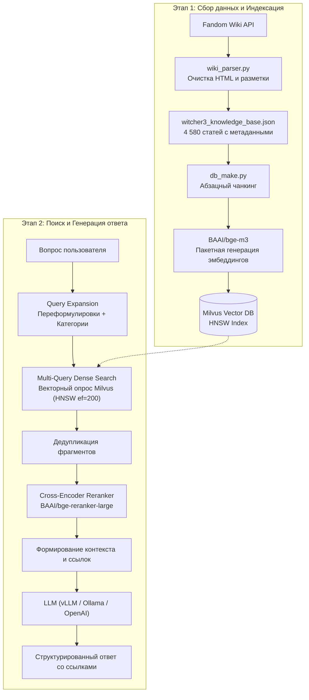

# 🐺 Witcher 3 RAG: Интеллектуальный ассистент по вселенной «Ведьмак 3»

[](https://www.python.org/downloads/)
[](https://python.langchain.com/)
[](https://milvus.io/)
[](https://huggingface.co/BAAI/bge-m3)
[](https://huggingface.co/BAAI/bge-reranker-large)

Полнофункциональная система **Retrieval-Augmented Generation (RAG)** с расширенным поиском по базе знаний игры **«Ведьмак 3: Дикая Охота»**, собранной с [Fandom Wiki](https://vedmak.fandom.com/).

Проект решает проблему галлюцинаций LLM при ответах на узкоспециализированные вопросы по лору, квестам, монстрам, уязвимостям бестиария, рецептам масел и эликсиров, предоставляя проверенную информацию с прямыми ссылками на первоисточники.

---

## 🌟 Ключевые особенности

- 📚 **Готовая база знаний:** 4 580 структурированных статей из русскоязычной Вики по Ведьмаку 3 (очищенный от HTML-тегов и навигационных шаблонов текст).
- 🧩 **Умный абзацный чанкинг:** Текст разделяется по смысловым абзацам без разрыва логических блоков и предложений.
- ⚡ **Векторная база Milvus & HNSW:** Высокоскоростной приближенный поиск ближайших соседей (ANN) с косинусной метрикой (`COSINE`, `efConstruction=200`, `M=16`).
- 🔄 **Query Expansion (Расширение запросов):** Автоматическая генерация синонимичных формулировок вопроса и подбор релевантных категорий через LLM для максимизации полноты выборки (Recall).
- 🎯 **Двухэтапный поиск (Dense + Cross-Encoder Reranking):** 
  1. Плотный векторный поиск кандидатов с помощью многоязычной модели **`BAAI/bge-m3`** (1024 dim).
  2. Глубокое переранжирование топ-кандидатов кросс-энкодером **`BAAI/bge-reranker-large`** для прецизионной точности (Precision).
- 🔗 **Точные цитаты и источники:** Каждый ответ сопровождается URL-ссылками на статьи Fandom Wiki и указанием тематических рубрик.
- 🤖 **Совместимость с любыми LLM:** Поддержка локальных серверов (vLLM, Ollama, LM Studio, TGI) и облачных API по стандартному OpenAI-протоколу.
- 🛠️ **Интеграция с агентами (Langroid):** Готовый класс инструмента (`RagSearchTool`) для автономных AI-агентов.

---

## 🏗️ Архитектура системы



---

## 📁 Структура репозитория

```
rag_project/
├── .env.example                    # Пример конфигурации переменных окружения
├── .gitignore                      # Исключения Git (кэш, venv, логи, .env)
├── docker-compose.yml              # Готовый стек Milvus Standalone (Milvus + MinIO + etcd)
├── requirements.txt                # Зависимости Python
├── config.py                       # Централизованный модуль настроек проекта
├── rag_inference.py                # Основной RAG-пайплайн и интерактивный CLI
├── rag_inference.ipynb             # Jupyter Notebook с пошаговой демонстрацией
├── witcher3_knowledge_base.json    # Выгруженная база знаний (4 580 статей, 13 МБ)
└── utils/
    ├── __init__.py                 # Пакет утилит
    ├── wiki_parser.py              # Рекурсивный парсер Fandom Wiki по категориям
    ├── db_make.py                  # Чанкинг, расчет эмбеддингов и запись в Milvus
    ├── db_read.py                  # CLI-утилита для проверки векторного поиска
    └── tools.py                    # Tool для интеграции с агентами (Langroid)
```

---

## 🚀 Быстрый старт

### 1. Клонирование и подготовка окружения

```bash
git clone <URL_РЕПОЗИТОРИЯ>
cd rag_project

# Создание виртуального окружения
python3 -m venv venv
source venv/bin/activate  # На Windows: venv\Scripts\activate

# Установка зависимостей
pip install --upgrade pip
pip install -r requirements.txt
```

### 2. Запуск векторной базы Milvus

Для локальной работы с векторной базой данных в репозиторий включен `docker-compose.yml`:

```bash
docker compose up -d
```

> **Проверка:** Milvus будет доступен на порту `19530`, а веб-консоль хранилища MinIO — на `http://localhost:9001` (логин: `minioadmin`, пароль: `minioadmin`).

### 3. Настройка конфигурации (`.env`)

Скопируйте шаблон переменных окружения:

```bash
cp .env.example .env
```

Отредактируйте `.env`, указав параметры вашего LLM-сервера (например, локальный vLLM, Ollama или внешний OpenAI):

```ini
# Параметры Milvus
MILVUS_HOST=localhost
MILVUS_PORT=19530

# LLM сервер (OpenAI-совместимый эндпоинт)
OPENAI_API_BASE=http://localhost:8000/v1
OPENAI_API_KEY=dummy-key
LLM_MODEL=meta-llama/Meta-Llama-3-8B-Instruct
```

---

### 4. Индексация базы знаний

База знаний `witcher3_knowledge_base.json` уже входит в репозиторий. Чтобы создать коллекцию и построить векторный HNSW-индекс в Milvus:

```bash
python utils/db_make.py
```

Параметры утилиты:
- `--batch-size 64` — размер пакета для вычисления эмбеддингов (увеличьте при наличии мощного GPU).
- `--data-file <путь>` — путь к альтернативному JSON-файлу.
- `--no-recreate` — не удалять существующую коллекцию при повторном запуске.

---

### 5. Проверка поиска (диагностика)

Вы можете протестировать качество векторного поиска без запуска LLM:

```bash
python utils/db_read.py -q "Кто такой Геральт из Ривии?" -k 3
```

---

### 6. Запуск диалогового ассистента (CLI)

Запустите интерактивную консоль:

```bash
python rag_inference.py
```

Пример диалога:

```text
======================================================================
🐺  WITCHER 3 RAG ASSISTANT  🐺
База знаний: 'Ведьмак 3: Дикая Охота' (Fandom Wiki)
Векторная база: Milvus (localhost:19530)
Модель:         meta-llama/Meta-Llama-3-8B-Instruct
Для выхода введите 'выход', 'quit' или 'exit'
======================================================================

[Ты] 🧙 > Что такое Дикая Охота?

[Поиск в архивах...]

[Ответ]
Дикая Охота (на Старшей Речи — Дearg Ruadhri, Красные Всадники) — это орда призрачных 
всадников, возглавляемая королём Эредином Бреакк Гласом. Они происходят из мира 
Aen Elle и вторгаются в мир Неверлэнда для захвата рабов, а также преследуют Цири 
из-за её способности управлять Пространством и Временем (Старшей Крови).

🔗 Источники:
   • https://vedmak.fandom.com/wiki/Дикая_Охота
   • https://vedmak.fandom.com/wiki/Эредин_Бреакк_Глас
🏷️  Категории: Категория:Персонажи, Категория:Ведьмак 3
```

Также поддерживается разовый запрос без входа в диалог:

```bash
python rag_inference.py -q "Какие слабости у полуденницы?"
```

---

## 💻 Использование в Python коде

Вы можете импортировать RAG-пайплайн как библиотеку в свои скрипты или веб-сервисы:

```python
from rag_inference import WitcherRAGPipeline

# Инициализация пайплайна
rag = WitcherRAGPipeline()

# Запрос с метаданными
result = rag.ask("Где найти доспехи школы Медведя?")

print("Ответ:", result["answer"])
print("Источники:", result["sources"])
print("Категории:", result["categories"])
```

---

## 🕷️ Обновление базы знаний (Парсер Вики)

Если вы хотите повторно спарсить актуальные статьи из Вики:

```bash
python utils/wiki_parser.py --delay 0.5 --max-depth 5
```

Ключи запуска:
- `--category` — стартовая категория (по умолчанию `"Категория:Ведьмак 3"`).
- `--output` — путь к файлу для сохранения (по умолчанию `witcher3_knowledge_base.json`).
- `--delay` — пауза между запросами к API в секундах (защита от rate-limit).
- `--max-depth` — предельная глубина рекурсивного обхода подкатегорий.

---

## ⚙️ Справочник параметров конфигурации (`.env`)

| Переменная | По умолчанию | Описание |
| :--- | :--- | :--- |
| `MILVUS_HOST` | `localhost` | Хост сервера Milvus |
| `MILVUS_PORT` | `19530` | gRPC порт Milvus |
| `COLLECTION_NAME` | `witcher3_rag` | Название коллекции в Milvus |
| `VECTOR_DIM` | `1024` | Размерность векторов (1024 для BGE-M3) |
| `EMBEDDING_MODEL` | `BAAI/bge-m3` | Модель HuggingFace для плотных эмбеддингов |
| `RERANKER_MODEL` | `BAAI/bge-reranker-large` | Модель Cross-Encoder для финального ранжирования |
| `OPENAI_API_BASE` | `http://localhost:8000/v1` | URL OpenAI-совместимого LLM сервера |
| `OPENAI_API_KEY` | `dummy-key` | API-ключ (для vLLM/Ollama может быть любым) |
| `LLM_MODEL` | `meta-llama/Meta-Llama-3-8B-Instruct` | Название модели LLM |
| `LLM_TEMPERATURE` | `0.3` | Температура генерации ответов |
| `TOP_K` | `4` | Число документов, передаваемых в итоговый контекст |
| `FETCH_K` | `20` | Число кандидатов для первичного отбора перед реранкером |
| `HNSW_EF` | `200` | Параметр точности HNSW-поиска в Milvus |
| `CHUNK_MAX_CHARS` | `2000` | Максимальная длина смыслового чанка (в символах) |
| `CHUNK_OVERLAP` | `100` | Перекрытие между чанками |

---

## 🛠️ Интеграция с AI-агентами (Langroid)

В файле [utils/tools.py](file:///home/user/balovstvo/rag_project/utils/tools.py) реализован инструмент `RagSearchTool`, совместимый с фреймворком **Langroid**:

```python
from langroid.agent.chat_agent import ChatAgent, ChatAgentConfig
from utils.tools import RagSearchTool

config = ChatAgentConfig(name="GeraltAdvisor")
agent = ChatAgent(config)
agent.enable_message(RagSearchTool)
```

---

## 📜 Лицензия и дисклеймер

Материалы базы знаний получены из открытой энциклопедии [Witcher Fandom Wiki](https://vedmak.fandom.com/) и распространяются в соответствии с условиями лицензии **CC-BY-SA**.
Все права на вселенную «Ведьмак» принадлежат Анджею Сапковскому и CD PROJEKT RED. Код проекта предназначен для образовательных и исследовательских целей.
